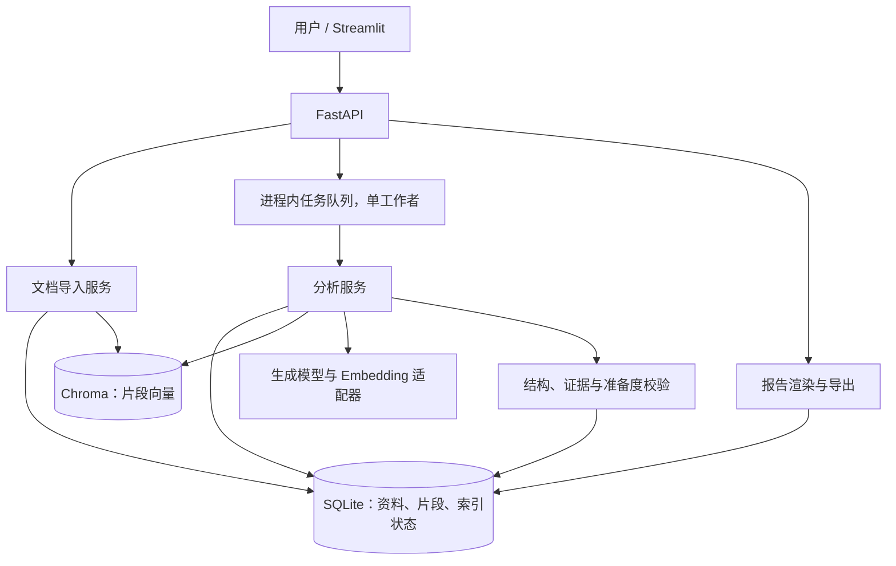

# ReproReady：Bug 复现材料补全助手——技术设计文档

版本：v0.2（加入日志证据处理，实施设计）  
日期：2026-10-27  
配套文档：`ReproReady-需求文档.md`

## 1. 设计目标

在约 36 小时开发预算内，实现一个单用户、可本地部署的 LangChain + RAG + 大模型应用：文档导入、问题抽取、版本化检索、检查清单分析、补充回答和 Markdown 导出。

采用模块化单体，不引入微服务、Redis、Celery 或多 Agent。所有分析仅访问已导入资料，没有终端、代码执行、联网搜索或外部写入工具。

## 2. 技术栈与选择理由

| 层次 | 选择 | 用途与边界 |
|---|---|---|
| 语言 | Python 3.11 | 统一 API、检索、模型调用及界面 |
| API | FastAPI + Uvicorn | 提供资料、Issue、分析任务和导出接口 |
| 输入与结构校验 | Pydantic v2 | 请求、模型结构化输出和证据校验 |
| 展示界面 | Streamlit + HTTPX | 三天内形成界面；仅通过 API 访问数据 |
| 模型与检索 | LangChain Core、Text Splitters、对应模型 Provider 包 | 提示词、结构化抽取、切分和模型调用 |
| 状态编排 | 普通 Python 服务函数 | 固定有限流程，首版不依赖 LangGraph |
| 向量索引 | Chroma 持久化本地模式 | 项目资料语义召回，不承担业务数据存储 |
| 向量模型 | 单独配置的 Embedding 服务 | 同一索引固定模型和维度 |
| 生成模型 | 支持结构化输出的对话模型 API | 事实抽取、缺口审查和草稿生成 |
| 业务存储 | SQLite + SQLAlchemy 2 | Issue、版本、任务、分析及证据记录 |
| 文档解析 | Python 文本读取 | 仅 Markdown/TXT，UTF-8/UTF-8 BOM |
| 日志解析 | Python 规则解析 | 常见格式结构化提取；无法识别时保留原文 |
| 上传 | python-multipart | multipart 文件接收 |
| 配置 | pydantic-settings | 环境变量与服务端密钥配置 |
| 开发检查 | pytest、Ruff | 核心规则、集成流程与格式检查 |
| 打包 | pyproject.toml + uv.lock，Docker Compose | 固定依赖；API/UI 两个服务，共用同一代码仓库 |

不预先声称某个包版本是最新或兼容。实施时先完成 Provider、LangChain、Chroma 的最小兼容验证，再生成并提交锁文件。统一选定一个模型 Provider，实现一个适配器即可；界面中的模型列表不属于首版范围。

调用生成模型与 Embedding 的凭证、地址、模型名分别配置；支持兼容接口的 Provider 也要验证其结构化输出能力，不假定接口兼容就意味着功能完全一致。

## 3. 系统架构



两个服务容器：`api` 负责数据库、文件和 Chroma；`ui` 只调用 API。API 单进程、单 worker，避免 SQLite 与内嵌 Chroma 的并发访问复杂性。持久化目录仅挂载给 API。

## 4. 建议项目框架

```text
repro-ready/
├── pyproject.toml
├── uv.lock
├── .env.example
├── .gitignore
├── Dockerfile
├── compose.yaml
├── README.md
├── LICENSE
├── docs/
│   ├── requirements.md
│   └── architecture.md
├── src/repro_ready/
│   ├── api/
│   │   ├── main.py
│   │   ├── dependencies.py
│   │   └── routes/
│   │       ├── projects.py
│   │       ├── documents.py
│   │       ├── issues.py
│   │       └── analyses.py
│   ├── core/
│   │   ├── config.py
│   │   ├── errors.py
│   │   └── redaction.py
│   ├── db/
│   │   ├── session.py
│   │   └── models.py
│   ├── schemas/
│   │   ├── issue.py
│   │   ├── analysis.py
│   │   └── evidence.py
│   ├── ingestion/
│   │   ├── loader.py
│   │   ├── chunker.py
│   │   └── indexer.py
│   ├── log_ingestion/
│   │   ├── parser.py
│   │   ├── redaction.py
│   │   └── patterns.py
│   ├── retrieval/
│   │   ├── retriever.py
│   │   └── citations.py
│   ├── analysis/
│   │   ├── pipeline.py
│   │   ├── extraction.py
│   │   ├── checklist.py
│   │   └── validation.py
│   ├── llm/
│   │   ├── provider.py
│   │   └── prompts/
│   │       ├── extract_v1.txt
│   │       └── review_v1.txt
│   ├── services/
│   │   ├── jobs.py
│   │   ├── issue_service.py
│   │   └── report_service.py
│   └── ui/
│       └── app.py
├── templates/
│   ├── checklist.yaml
│   └── report.md.j2
├── examples/demo-order-service/
│   ├── docs/
│   ├── issues/
│   └── expected/
├── scripts/
│   ├── load_demo.py
│   └── evaluate.py
├── tests/
│   ├── test_citations.py
│   ├── test_log_parser.py
│   ├── test_readiness.py
│   ├── test_version_isolation.py
│   └── test_analysis_flow.py
└── data/                       # 忽略提交
    ├── app.db
    ├── uploads/
    └── chroma/
```

目录表示逻辑边界，不要求第一天一次建齐所有文件。先打通一条端到端流程，再按职责拆分，避免空壳过多。

## 5. 数据模型

主要表及字段如下，ID 使用 UUID，时间使用 UTC：

| 表 | 关键字段 |
|---|---|
| Project | id、name、description |
| KnowledgeVersion | id、project_id、label、status、embedding_model、embedding_dimension、chunk_config、manifest_hash |
| Document | id、knowledge_version_id、original_name、content_hash、sanitized_text、line_count、status |
| Chunk | id、document_id、start_line、end_line、heading、text、content_hash |
| Issue | id、project_id、knowledge_version_id、title、revision、created_at |
| IssueRevision | id、issue_id、revision、sanitized_input、attachment_manifest、created_at |
| LogRecord | id、issue_revision_id、source、original_name、normalized_text、parsed_json、parse_status、content_hash |
| Analysis | id、issue_revision_id、status、stage、readiness、result_json、error_code、model_id、prompt_version、retrieval_config、started_at、finished_at |
| AnalysisEvidence | id、analysis_id、source_kind、source_id、start_line、end_line、text_snapshot |
| Clarification | id、issue_id、base_analysis_id、question_id、answer、created_at |
| ExecutionRecord | id、issue_id、analysis_id、status、notes、created_at |

模型输入和引用使用脱敏后的规范文本，原始附件默认不持久化。日志保存脱敏后的规范文本和解析字段；提交分析前用户可复核脱敏结果。行号指规范文本行号，界面与导出明确标注；规范化统一换行符，脱敏不删除整行。

`source_kind` 可为 `project_document`、`issue_text`、`issue_log`、`issue_attachment`、`clarification`。向量库只索引项目资料，用户日志直接作为本次分析证据，不混入通用知识库。

资料版本在创建后进入 `draft`，允许上传。封存时进入 `indexing`，全部完成后变为 `ready`；失败为 `failed`，可重试。`ready` 版本不可变更。只有 `ready` 版本允许分析。

## 6. 文档导入与索引

1. 校验扩展名、数量、字节大小、UTF-8 可解码性；拒绝二进制内容。
2. 规范化换行和基本脱敏，按 SHA-256 去重；原文件名仅作为展示元数据，落盘使用生成 ID。
3. 保存规范文本及行号。按 Markdown 标题和段落切分，长段落再按有界长度切分，直接保留行范围。
4. 起始配置：每块约 600–1,200 字符，重叠约 100–150 字符；实际按资料和模型上下文调整。
5. 将 Chunk 写入 SQLite，计算 Embedding，使用稳定 chunk ID upsert 到 Chroma。
6. 每个版本单独建立 collection，保存项目 ID、版本 ID、文档 ID、行范围和模型配置；所有查询均由服务端绑定版本。
7. 全部向量完成后验证片段数量并将版本置为 `ready`。失败版本不参与检索，重试利用稳定 ID 避免重复。

`manifest_hash` 由文档哈希和索引配置计算。更换 Embedding 模型、维度或切分策略时创建新版本/索引，不复用旧向量。首版无跨版本检索。

## 7. RAG 分析流程

### 7.1 固定有限流程

```text
输入校验与快照
  → 日志脱敏、解析并生成行级证据
  → 提取事实
  → 按检查项构造检索查询
  → 同版本召回与证据裁剪
  → 缺口审查 + 追问 + 步骤草稿
  → 证据校验 + 准备度计算
  → 存储结果与渲染报告
```

这是一条有状态的分析工作流，可称为受限的复现准备助手，但不宣传为自主执行 Agent。LangChain 用于模型结构化输出和检索集成，普通 Python 负责顺序、预算和业务规则。

后续若需要“发现证据不足后继续检索”的分支和中断恢复，可将这些阶段映射为 LangGraph 节点，复用同一 schema；当前三天目标不要求引入。

### 7.2 事实提取

先用确定性规则解析日志，再交由模型整理语义。解析字段包括 timestamp、level、exception_type、http_status、request_path、trace_id 和堆栈范围，每个字段绑定来源、行号与提取规则版本。字段缺失保留 null，不按常见配置补全；未知格式保留全部规范原文。多条事件分别保存，不把不同事件的路径、时间和堆栈拼成一个事件，也不根据时间接近就宣称属于同一请求。

模型读取用户输入和附件，输出 `facts[]`，字段包含 category、value、source_id、原文片段和行范围。此阶段不读取项目文档，避免把规范要求当作实际环境。

对摘要事实保留原始引文，服务端校验引文确实存在于指定来源。未提及的值保留 null，不能根据常见默认配置补全。

### 7.3 检索

根据问题现象与检查项构造最多 4 个查询，例如运行环境、接口输入、权限前置和初始化数据。优先由规则结合抽取事实构造，首版不增加模型查询改写调用。

每个查询召回 top-4，合并去重后最多保留 10 个片段，按相关性和检查项覆盖裁剪到总上下文预算。可使用 MMR 减少相似片段；P1 再加入 BM25 混合检索。

向量距离不直接解释为置信度。找不到足够依据时允许返回空证据，报告标注资料不足；检索异常则返回失败，不能把故障当成“无相关资料”。

### 7.4 审查与草稿

传入已校验事实、项目检查模板、片段 ID 和原文。模型一次输出检查项、优先追问与步骤草稿，不直接生成最终 Markdown。

每条判断必须区分：用户事实、项目要求、推测、未知。资料只作为数据。追问最多 5 个，优先覆盖会阻止执行的缺口；更多缺口仍在清单中保留。

### 7.5 服务端证据校验

- 模型只能引用本次输入白名单中的来源 ID。
- 校验来源属于本项目版本或本次 Issue 快照，且行号范围有效。
- 校验 quoted_text 与规范原文一致；全文/引用快照来自服务端，不采用模型伪造的原文。
- 无效引用触发有限修正；仍失败时该分析失败，不生成貌似成功的报告。
- 引用存在性可程序验证，语义支持性仍需评估和人工复查，不等价于真实性保证。
- 服务端依据模板与已校验阻塞项计算准备度；日志中出现成功字样也不能自动写入人工执行结果。

## 8. 结构化输出约定

以下为结果字段设计，落地时转换为 Pydantic 模型：

```json
{
  "summary": "订单创建返回 403",
  "facts": [
    {
      "category": "actual_result",
      "value": "POST /orders 返回 403",
      "evidence_ids": ["ev-issue-1"]
    }
  ],
  "checks": [
    {
      "id": "auth_precondition",
      "status": "missing",
      "blocking": true,
      "reason": "文档要求管理员角色，报告未说明当前角色",
      "evidence_ids": ["ev-doc-3"]
    }
  ],
  "questions": [
    {
      "id": "q1",
      "check_id": "auth_precondition",
      "text": "当前账号具有哪个角色？请勿提供实际 Token。"
    }
  ],
  "reproduction_steps": [
    {
      "order": 1,
      "text": "使用 [待补充角色] 的测试账号登录",
      "evidence_ids": ["ev-doc-3"],
      "needs_confirmation": true
    }
  ]
}
```

示例 ID 只是说明结构。实际 evidence ID 由服务端生成，先提供给模型，不能由模型任意创建。`readiness`、执行结果、时间和模型配置由服务端添加。

缺失项可无引用，但必须说明是“用户未提供”或“模板要求”；如果理由引用了项目规则，则必须有项目文档证据。步骤里的推测条件必须显式标记，不能伪装成已发生事实。

## 9. API 设计

统一路径前缀 `/api/v1`：

| 方法与路径 | 用途 | 主要返回 |
|---|---|---|
| GET `/health` | 服务健康，不触发付费模型调用 | 状态、版本 |
| POST `/projects` | 创建项目 | project_id |
| GET `/projects` | 列出项目 | projects |
| POST `/projects/{id}/knowledge-versions` | 创建 draft 版本 | version_id |
| GET `/projects/{id}/knowledge-versions` | 查询版本与索引状态 | versions |
| POST `/knowledge-versions/{id}/documents` | 上传资料 | 文档 ID 和状态 |
| POST `/knowledge-versions/{id}/index` | 封存并排队索引；failed 可重试 | 202、version_id |
| GET `/knowledge-versions/{id}` | 查询版本索引阶段、错误和文档列表 | version |
| POST `/issues` | 以 JSON 创建 Issue 及初始快照 | issue_id、revision |
| POST `/issues/{id}/logs` | 补充粘贴或上传日志，创建新 revision | revision、log_ids、解析摘要 |
| GET `/issues/{id}/logs` | 按 revision 查询日志及规范原文 | logs |
| GET `/issues` | 查询问题列表 | issues |
| GET `/issues/{id}` | 查询问题、补充和历史分析 | issue |
| POST `/issues/{id}/analyses` | 提交分析，绑定当前 revision | 202、analysis_id |
| GET `/analyses/{id}` | 查询状态、结果与耗时 | analysis |
| POST `/issues/{id}/clarifications` | 提交回答并创建新 revision | revision |
| GET `/analyses/{id}/evidence/{evidence_id}` | 返回允许引用的原文快照 | evidence |
| GET `/analyses/{id}/report.md` | 下载已成功分析的 Markdown | text/markdown |
| POST `/issues/{id}/execution-records` | 人工记录执行结果 | record_id |

创建 Issue 用 JSON；日志用专门接口上传，资料上传使用 multipart。`POST analyses` 不隐式创建版本或重新索引。

创建 Issue 后通过日志接口追加材料。日志接口统一使用 multipart：payload 指定 expected_revision、来源、kind（log/config）和可选粘贴文本，files 接收对应格式。已分析快照不能原地追加；新 revision 继承已有材料并添加日志或配置，旧报告保留旧来源。revision 不匹配返回 409，用户显式触发新分析。日志只作为 Issue 证据，不走项目文档索引接口。配置 kind 作为 issue_attachment 保存，不强行套用日志解析器。

补充回答带 `base_analysis_id` 和 question_id；若不是当前 revision 的最新成功分析，返回 409，防止把旧问题答案静默覆盖新内容。提交回答后由用户显式触发新分析。

对同一 revision 的重复分析，若已有运行任务则返回该任务；成功后再次请求可复用结果，除非显式设置 force=true。保留每次实际运行记录，不用相同 ID 覆盖旧报告。

状态码：400 非法状态/参数，404 不存在，409 版本或并发冲突，413 超限，422 结构不合法，429 队列已满，503 服务不可用。错误体统一为 `{error: {code, message, request_id}}`，不把模型密钥、堆栈或输入全文返回给用户。

## 10. 异步任务与失败处理

- 使用进程内有界队列与单后台工作者；索引与分析共享队列串行运行，避免两个服务同时写内嵌索引。
- 入队前持久化任务状态，入队失败则保存可重试失败状态，不留下永久 queued 记录。
- 分析状态：`queued → running → succeeded/failed/interrupted`。
- 进程重启时，将遗留 queued/running 分析标记为 interrupted；索引标记 failed 并允许幂等重建。首版不承诺任务自动恢复。
- 每个任务独立数据库 session，不能复用 HTTP 请求 session；不用同步的长模型调用阻塞 API 事件循环。
- 单次生成调用超时初始设 45 秒；分析任务总时限 180 秒，达到时限停止安排后续调用并标记失败。索引另设总时限 300 秒。
- 每次分析最多 4 次生成请求，含格式修正及网络重试；正常路径 2 次。仅对超时、429 和临时 5xx 有限重试，所有重试共用预算与总时限。
- 上传规模有限，但 Embedding 请求也要有超时和重试上限；不能因部分索引成功就宣告 ready。
- 不记录或展示模型内部思维链，只记录阶段、耗时、工具名、片段 ID、模型调用数和错误码。

## 11. 输入与上下文预算

初始限制建议：单资料文件 1 MiB，一个版本最多 20 个文件；单 Issue 每个 revision 最多 3 个日志文件、每个 256 KiB；问题描述最多 20,000 字符。

每个 revision 的继承和新增日志合计计入附件总额，粘贴日志也占一个附件额度，防止多次补充绕过限制。日志接受 `.log` / `.txt`；配置片段接受 `.txt` / `.md`；仅 UTF-8/UTF-8 BOM。解析状态为 parsed、partial 或 unrecognized；后两者仍保留原文，不把字段为空当作接收失败。畸形行、超长行和无法解码文件都需要明确处理，解析不得导致 API 崩溃。

超限返回清晰错误，不静默截断上传内容。日志过长时要求用户提供相关片段；后续可加入可见的裁剪确认。

分析输入还需要独立 token 预算：例如选用至少 32k 上下文的模型，给问题与日志 8k、检索片段 8k、提示与 schema 4k、输出 4k，其余预留。实际预算以所选模型能力与 tokenizer 为准；附件即使满足字节限制，也可能因 token 超限被拒绝。

不支持 tokenizer 时采用保守估算并保留余量，不能声称精确。记录被选入分析的资料和范围，必要时提示用户缩小输入。

## 12. 配置示例

```dotenv
APP_ENV=local
DATABASE_URL=sqlite:///./data/app.db
CHROMA_DIR=./data/chroma
UPLOAD_DIR=./data/uploads
LLM_PROVIDER=selected-provider
LLM_API_KEY=replace-me
LLM_BASE_URL=
LLM_MODEL=replace-me
EMBEDDING_API_KEY=replace-me
EMBEDDING_BASE_URL=
EMBEDDING_MODEL=replace-me
MAX_ANALYSIS_CALLS=4
MODEL_TIMEOUT_SECONDS=45
ANALYSIS_TIMEOUT_SECONDS=180
INDEX_TIMEOUT_SECONDS=300
TASK_QUEUE_SIZE=8
UI_API_BASE_URL=http://127.0.0.1:8000
```

这是配置契约示例，实施后需与 config.py 一致。密钥仅由 API 读取，不能送到界面或写进报告。容器 UI 的地址改为 `http://api:8000`，API 数据路径改为 `/app/data`。

Docker 端口只绑定宿主机 127.0.0.1；容器内监听 0.0.0.0。首版无鉴权，不适合直接对公网开放。Streamlit 由服务端调用 API，无需为浏览器放开宽泛 CORS。

## 13. 报告与补充版本

报告使用 Jinja2 模板渲染服务端校验后的结果，不让模型直接控制 HTML。展示内容按纯文本或受控 Markdown 渲染，不开启不安全 HTML。

报告包含分析 ID、Issue revision、资料版本/manifest、模型标识、提示词版本、创建时间、准备度和人工执行记录。复现命令只是文本，没有执行入口。

补充后的分析使用新的完整输入快照，并保留每条回答来源；不能把上一轮模型推测自动提升为新一轮事实。旧报告引用保留原证据快照，即使未来扩展资料删除，也不应失去历史可读性。

## 14. 验证方案

### 14.1 核心自动检查

- 引用来源不存在、越界、跨版本时必须拒绝。
- 日志 fixture 覆盖 Java/Python/Node.js、未知格式、多行堆栈和多事件边界；验证字段有行级来源。
- 验证日志脱敏、大小限制、追加 revision、旧报告不变，以及无 Trace ID 时不会一律阻塞复现。
- 资料规则不能直接成为用户环境事实。
- 有阻塞缺口时不能计算为 ready_for_manual_attempt。
- 重复入队、模型结构错误和超时不会生成伪成功状态。
- 新补充产生新 revision，历史分析不被覆盖。

### 14.2 集成与真实模型验证

自动集成测试使用确定性的模型/Embedding 替身，以检查数据流与异常路径；另外以真实模型运行固定 12 案例评估，检查语义效果。替身测试通过不能代表模型分析准确。

评估报告记录缺口精确率/召回率、有效引用率、人工判断的证据支持性、单次耗时、调用数及失败样例。费用只有在获取实际 usage 且有对应价格依据时估算。

### 14.3 最终演示

1. 加载 demo-v1 资料。
2. 提交“创建订单 403”的不完整报告。
3. 同时上传错误日志，查看解析字段与行级原文；未知格式仍可作为证据查看。
4. 系统找到角色要求，追问账号角色和请求信息。
5. 用户补充已知信息，生成新分析。
6. 报告仍未知的信息继续标记未知；人工执行后手动记录结果。
7. 导出包含文档与日志证据的 Markdown，并展示评估和已知限制。

## 15. 实施顺序与发布交付

第一优先级是一个问题能获得有依据的缺口和草稿；第二优先级是补充与版本快照；最后补齐错误处理、打包和演示。不要先搭建通用 Agent 框架或复杂前端。

预期本地命令接口如下，真正可执行命令须在实现后验证：

```bash
uv sync --locked
uv run uvicorn repro_ready.api.main:app --host 127.0.0.1 --port 8000
uv run streamlit run src/repro_ready/ui/app.py
uv run pytest
uv run ruff check .
uv run python scripts/evaluate.py
docker compose up --build
```

API 和 UI 在两个终端启动；Docker 是替代启动方式，无需同时运行。项目包在 pyproject.toml 中配置 src 布局。

GitHub 交付包括源码、锁文件、示例数据与标注、两份文档、配置示例、启动方式、许可证、约一分钟录屏，以及真实运行得到的评估结果。当前文档是实施规格，不表示代码、命令或性能已经验证。
